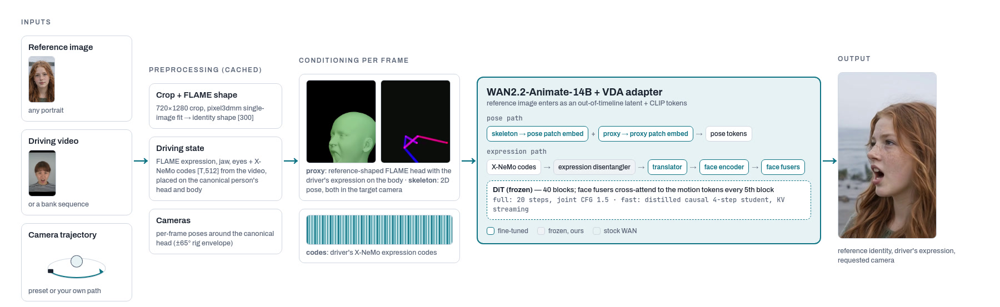
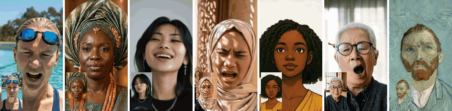

# video-diffusion-avatars (VDA)

**Video Diffusion Avatars: Taming Video Diffusion Models into Controllable 3D Avatars** ·
[Paper (arXiv)](https://arxiv.org/abs/2610.23772) ·
[Project page](https://simongiebenhain.github.io/video-diffusion-avatars/) ·
[Weights on Hugging Face](https://huggingface.co/SimonGiebenhain/video-diffusion-avatars)

Expression- and camera-controllable portrait animation on **WAN2.2-Animate-14B**. Give it a **reference image**, a
**driving video** and a **camera trajectory**; it generates the reference person performing the driver's
expressions, seen from the requested viewpoints.



| model | what it is | use it for |
|---|---|---|
| **full** | VDA adapter on WAN2.2-Animate-14B, 20 sampling steps | best quality; 77 frames (3.2 s) per clip |
| **fast** | distilled 4-step student, streamed on a KV cache | videos of any length; ~3.5 fps at 288p (A100) |

Both generate at 288×512, 576×1024 (default) or 720×1280.



The teaser [examples](docs/examples.md), generated with the full model; inset: the reference image.

## Contents

1. [Quick start](#1-quick-start): [requirements](#11-requirements), [install](#12-install), [weights](#13-weights),
   [examples](#14-run-the-examples)
2. [Your own data](#2-your-own-data): [reference image](#21-reference-image), [driving video](#22-driving-video),
   [camera](#23-camera), [generate](#24-generate)
3. [Long videos: the distilled model](#3-long-videos-the-distilled-model)
4. [Runtime and memory](#4-runtime-and-memory)
5. [Reference](#5-reference): [models](#51-models), [documentation](#52-documentation), [files](#53-files),
   [licences](#54-licences), [citation](#55-citation)

More detail: [examples](docs/examples.md) · [reference images](docs/reference_images.md) ·
[driving videos](docs/driving.md) · [cameras](docs/cameras.md) · [commands, paths, Python](docs/python.md)

---

## 1. Quick start

`<ANGLE_BRACKETS>` mark values you choose.

### 1.1 Requirements

* Linux, NVIDIA driver for CUDA 12.8, conda, `ffmpeg`, gcc 9-14.
* GPU: 48 GB for the full model (all resolutions) and the fast model at 288p; 80 GB for the fast model at 576p / 720p
  ([4](#4-runtime-and-memory)).
* Disk: ~65 GB: weights ~44 GB (ours 6.5 GB + the public WAN files 37 GB), the conda env ~13 GB, preprocessing
  models and caches ~7 GB.
* A free [FLAME](https://flame.is.tue.mpg.de) account. The installer downloads FLAME 2020 with it (its licence does not
  allow us to ship the model): it asks for the login in the terminal, or reads `FLAME_USERNAME` / `FLAME_PASSWORD`;
  `FLAME_ZIP_DIR=<DIR>` uses a `FLAME2020.zip` you already downloaded. Without a terminal and without these
  variables it stops with an explanation.

### 1.2 Install

```bash
git clone https://github.com/SimonGiebenhain/video-diffusion-avatars.git video-diffusion-avatars
cd video-diffusion-avatars
bash envs/setup_env.sh          # one conda env `vda` (VDA_ENV_NAME=<ENV> to rename it); ~30 min, needs a GPU
conda activate vda
```
All commands below run in the `vda` env, from this folder. Each step is a Python script in this folder
(`download.py`, `prepare_reference.py`, `prepare_driving.py`, `render_conditioning.py`, `generate.py`) that calls the
code in `vda/`; every script has `--help`.

<details markdown="1">
<summary>Environment details</summary>

The env pins Python 3.12, torch 2.10.0 + CUDA 12.8, transformers 5.12.1 and peft 0.19.1 (the versions the reference
renders were made with) and adds the preprocessing stack (pixel3dmm, pytorch3d, nvdiffrast, face_alignment,
diffusers). The script freezes the generation versions first and stops if a later install would change one. It also
installs this repository as the editable package `video-diffusion-avatars`, so `import vda` works from other
repositories ([docs/python.md](docs/python.md)).

* Do not install flash-attn, sage-attention or xformers into `vda`: outputs would no longer match the reference
  renders (made with torch SDPA).
* If your default gcc is newer than 14: `CC=<GCC> CXX=<G++> CUDAHOSTCXX=<G++> bash envs/setup_env.sh`.
* The preprocessing installer (`third_party/pixel3dmm/install_preprocessing_pipeline.sh`, run by `setup_env.sh`)
  clones facer, PIPNet and MICA at pinned commits (MICA only for its FLAME data files), downloads FLAME 2020, the
  pixel3dmm networks and the PIPNet landmark model, and checks every file's md5. Re-running it skips what is already
  in place.
* On first use, the preprocessing models download into the standard torch hub / Hugging Face caches (~1.2 GB;
  `TORCH_HOME` / `HF_HOME` move them).
* `--motion driver` (the driver's own head and body motion, [docs/driving.md](docs/driving.md)) additionally needs
  [SAM 3D Body](https://github.com/facebookresearch/sam-3d-body) in its own env.
* Harmless log messages: `[info] no MICA identity ... starting from the mean face` (VDA does not use MICA),
  conda's `WARNING: overwriting environment variables ... CUDA_HOME` (the env sets its own CUDA), and the
  `No wan_video_text_encoder models available` line (the prompt embeddings are cached).

</details>

### 1.3 Weights

```bash
python download.py weights      # our weights (~6.5 GB) from Hugging Face into weights/, md5-checked
python download.py base         # the public WAN2.2-Animate-14B files (~37 GB) into weights/base/
```
Our weights, the examples and the example driving videos are on
[Hugging Face](https://huggingface.co/SimonGiebenhain/video-diffusion-avatars). `download.py base` fetches from
ModelScope; add `--source huggingface` to use the Hugging Face mirror. To keep the weights elsewhere,
`export VDA_WEIGHTS=<DIR>` before both commands (and in your shell profile).

### 1.4 Run the examples

The 25 examples from the [project page](https://simongiebenhain.github.io/video-diffusion-avatars/) come with their
conditioning precomputed (reference image, proxy render, skeleton and expression codes), so they run without any
preprocessing:
```bash
python download.py examples     # ~220 MB into examples/: the 25 examples + the example driving videos
python generate.py --cond examples/teaser_swimmer --out outputs/teaser_swimmer.mp4
```
This is the swimmer from the teaser, driven by a NeRSemble performance (disgust → happy) while the camera goes over
her head. Every example runs the same way; [docs/examples.md](docs/examples.md) lists all 25 with their references,
drivers and cameras. The `distilled_*` examples are for the fast model ([3](#3-long-videos-the-distilled-model)).

---

## 2. Your own data

Three preparation steps, each cached in `cache/` under a name you choose: the reference photo (once per person), the
driving video (once per video), the conditioning for a camera path; then generate.

`bash scripts/run_example.sh <PHOTO.jpg> <NAME>` runs all of it for a new photo with the example driving video
`examples/drivers/disgust_happy.mp4` (`--driver <DRIVER.mp4>` for another one) and the `over_the_top_zoom` camera, and
writes `outputs/<NAME>.mp4`.

### 2.1 Reference image

```bash
python prepare_reference.py --image <PHOTO.jpg> --name <NAME>    # ~3 min; --min_conf 0.25 for paintings, cartoons, statues
```
Any near-frontal portrait with some margin around the head. It is cropped to 720×1280 with the face at a fixed size
and position, and its FLAME head shape is fitted; both are cached in `cache/refs/<NAME>/`. What makes a good
reference, the crop convention and the shipped references: [docs/reference_images.md](docs/reference_images.md).

### 2.2 Driving video

Any video of one face, roughly frontal. The driving videos of the project page come with the examples, in
`examples/drivers/`: `disgust_happy`, `tongue_out`, `shout_laugh`, `jaw`, `surprise_fear` and `cheeks_nose`
(NeRSemble performances, 3.4 s each).
```bash
python prepare_driving.py --video examples/drivers/tongue_out.mp4 --name tongue_out    # or --video <DRIVER.mp4> --name <DRV>
```
This tracks the expression, jaw, gaze and blinks in the video and transfers them onto a canonical person, whose head
and upper body move naturally (~17 min for these 81-frame videos on an RTX A6000). The result is cached in `cache/driving/<DRV>/`. To transfer the driver's own
head and body motion as well, see [docs/driving.md](docs/driving.md) (`--motion driver`, with SAM 3D Body).

### 2.3 Camera

```bash
python render_conditioning.py --ref <NAME> --driving tongue_out --camera over_the_top_zoom --out_dir cache/cond/<RUN>
```
Renders the conditioning (proxy render, skeleton, expression codes) for the reference `<NAME>` (2.1) and the driving
video `tongue_out` (2.2) into the chosen camera path; `<RUN>` is any name for the result. The full model uses the first
77 frames: for a driving video longer than that, add `--max_frames 77`, otherwise the camera path is stretched over the
whole video and the clip shows only its beginning.

Recommended cameras: `over_the_top_zoom` (over the head and back, with zoom), `over_the_top_zoom_55` (gentler, for
drivers who move a lot), `ladder_zoom_m` (above → profile → below). All 17 presets with a figure, and how to write
your own path: [docs/cameras.md](docs/cameras.md). The training cameras cover ±65° azimuth and ±17° elevation; quality
degrades gradually beyond that.

### 2.4 Generate

```bash
python generate.py --cond cache/cond/<RUN> --out <OUT.mp4>
```

The full model generates the first 77 frames (3.2 s) of the conditioning; a shorter one gives the largest 4k+1 frames
(e.g. 69 of 71). For longer videos use the fast model ([3](#3-long-videos-the-distilled-model)).

| option | default | meaning |
|---|---|---|
| `--model` | `full` | `full` or `fast` ([3](#3-long-videos-the-distilled-model)) |
| `--width`, `--height` | full 576×1024, fast 288×512 | output size: 288×512, 576×1024 or 720×1280 |
| `--seed` | 42 | same seed + same GPU model + same conditioning folder = identical video (re-rendering the conditioning adds tiny pixel noise, ~49 dB PSNR) |
| `--fps` | 24 | frame rate of the file |
| `--png` | off | also write lossless frames |

<details markdown="1">
<summary>More options</summary>

| option | default | meaning |
|---|---|---|
| `--ref` | `<cond>/ref.png` | another reference image (or a `prepare_reference.py` name) than the one the conditioning was made for |
| `--offload_blocks` | from GPU memory and resolution ([4](#4-runtime-and-memory)) | DiT blocks (of 40) streamed from host memory: less VRAM, same output, slower |
| `--vae_tiled` | on | `off` is faster on 80 GB GPUs but changes pixels slightly |

</details>

---

## 3. Long videos: the distilled model

The full model makes one 77-frame clip (3.2 s) per call. For longer videos use the fast model, a distilled 4-step
student that streams the video in 16-frame blocks on a KV cache, any length at ~3.5 fps (288×512, A100, including decoding). It starts with
a short pass of its full-quality teacher for the first 77 frames, which keeps the identity stable.

```bash
python generate.py --model fast --cond examples/distilled_redbangs --out outputs/distilled_redbangs.mp4 --deflicker
```
41 s, camera swinging between the sides. `--deflicker` also writes `outputs/distilled_redbangs_dfs.mp4`: the student
can shift the colour slightly from one 16-frame block to the next, and the deflicker pass measures these jumps on a
coarse colour grid and fades them out over a few frames (a post-process; recommended).

The `distilled_*` examples use the long driving sequence `nersemble8` that comes with the weights: eight NeRSemble
performances joined by short transitions, 41 s in total ([docs/driving.md](docs/driving.md)). With your own reference:
```bash
python render_conditioning.py --ref <NAME> --driving nersemble8 --camera sweep_41s --out_dir cache/cond/<RUN>
python generate.py --model fast --cond cache/cond/<RUN> --out <OUT.mp4> --deflicker
```
A long driving video of your own works the same way (`--driving <DRV>` from [2.2](#22-driving-video)); the camera path
is cut to its length. The fast model generates at 288×512 by default (`--width 576 --height 1024` needs 80 GB). It can
drift in colour on dark backgrounds after ~20 s; another `--seed` usually helps.

---

## 4. Runtime and memory

Measured with this code unless noted. *Streamed* = DiT blocks (of 40) kept in host memory and copied to the GPU for
each forward pass (`--offload_blocks`, chosen automatically, see below).

| model | resolution | clip | GPU | streamed | time | peak VRAM |
|---|---|---|---|---|---|---|
| full | 576×1024 | 77 frames | A100 80 GB | 0 | 20 steps × 35 s ≈ 12 min (+ ~2 min loading, decoding) | 43 GB |
| full | 576×1024 | 77 frames | RTX A6000 48 GB | 0 | 25 min, incl. loading | 43 GB |
| full | 720×1280 | 77 frames | RTX A6000 48 GB | 20 | 51 min, incl. loading | 40 GB |
| fast | 288×512 | 1029 frames (41 s) | A100 80 GB | 0 | 2 min teacher start + 3.4 min streaming (5.0 fps generation, ~3.5 fps incl. decoding) | 47 GB |
| fast | 288×512 | 1029 frames (41 s) | RTX A6000 48 GB | 12 | 3.6 min teacher start + 14 min streaming (1.2 fps generation) | 40 GB |
| fast | 576×1024 | 144 frames (6 s) | A100 80 GB | 20 | 12 min teacher start + 3 min streaming (0.6 fps) | 60 GB |
| fast | 720×1280 | 1029 frames | A100 80 GB | 36 | 25 min teacher start + 55 s per 16 frames (measured with a pre-release implementation of the same model) | 74 GB |

The fast model always starts with a one-off "teacher" pass for the first 77 frames; the longer the video, the
smaller its share.

**GPU memory.** Streaming blocks lowers peak VRAM by ~0.8 GB per block and gives exactly the same video, but every
denoising step waits for the copies, so it is slower. `generate.py` picks the smallest setting that fits:

| model | GPU | 288×512 | 576×1024 | 720×1280 |
|---|---|---|---|---|
| full | ≥ 60 GB | 0 | 0 | 0 |
| full | < 60 GB | 0 | 0 | 20 |
| fast | ≥ 60 GB | 0 | 20 | 36 |
| fast | < 60 GB | 12 | 20 | 36 |

On GPUs with more memory nothing is streamed and generation runs at full speed. Override with
`--offload_blocks <N>`: lower N if your GPU has memory to spare (faster), raise it if you run out of memory
(`torch.OutOfMemoryError`). When blocks are streamed the log says so (`[vda] N/40 DiT blocks streamed from host
memory; resident X GiB`); the `offload_blocks` entry in `<OUT>.json` always records what a run used.

Preprocessing (any CUDA GPU ≥ 12 GB): reference 2-3 min; driving video ~17 min for 81 frames (RTX A6000, mostly the
per-frame face tracking); conditioning ~1 min per 1000 frames.

---

## 5. Reference

### 5.1 Models

**Full.** WAN2.2-Animate-14B (frozen) + `vda_full.safetensors`. 20 Euler steps with joint identity + expression
guidance (scale 1.5, 2 passes per step). 77 frames per call.

**Fast.** WAN2.2-Animate-14B + `vda_fast_base.safetensors` + `vda_fast_student.safetensors`. A causal 4-step
student (distilled with Self Forcing) generates 16-frame blocks on a KV cache. It attends to the reference and to a
window of 20 latent frames (77 video frames, the trained clip length), of which the first 12 stay fixed as an
attention sink; the first 77 frames come from its bidirectional teacher. The student was distilled from a
separately fine-tuned adapter of the same architecture (`vda_fast_base.safetensors`, also its teacher), hence its
own base file.

**Conditioning.** Per frame, in the target camera: the *proxy render* (`pose_proxy.mp4`, a FLAME head with the
reference's shape and the driver's expression on a body, shaded by view direction), the 2D *skeleton*
(`pose_skel.mp4`) and the driver's X-NeMo expression *codes* (`codes.npy`). Inside the model the codes pass a
frozen expression disentangler ([docs/python.md](docs/python.md#expression-disentangler)) and a translator into
WAN-Animate's motion-code space; the proxy render enters through its own patch embedding next to the skeleton.

### 5.2 Documentation

| page | contents |
|---|---|
| [docs/examples.md](docs/examples.md) | the 25 examples: references, drivers, cameras, how to run them |
| [docs/reference_images.md](docs/reference_images.md) | what makes a good reference, the crop convention, the shipped references |
| [docs/driving.md](docs/driving.md) | the shipped driving sequence and its takes, own driving videos, head and body motion, SAM 3D Body |
| [docs/cameras.md](docs/cameras.md) | all camera presets with a figure, timing, writing your own camera path |
| [docs/python.md](docs/python.md) | all commands, where files go, using VDA from Python / another repository, the expression disentangler |

### 5.3 Files

<details markdown="1">
<summary>Weights (<code>weights/</code> or <code>$VDA_WEIGHTS</code>)</summary>

| file | size | for |
|---|---|---|
| `vda_full.safetensors` | 1.73 GB | full model |
| `vda_fast_base.safetensors`, `vda_fast_student.safetensors` | 1.73 + 2.60 GB | fast model |
| `xnemo_disentangler.pt` | 26 MB | both models, standalone disentangler |
| `text_emb_cache.pt` | 17 MB | both models (prompt embeddings; avoids the 11 GB text encoder) |
| `driving_bank/nersemble8.npz`, `nersemble8.takes.json` | 153 MB | the 41 s driving sequence (8 NeRSemble performances); its person is also the canonical person for your own driving videos |
| `driving_bank/nersemble8_canonical_body.npz` | 13 KB | `--motion driver` |
| `third_party/xnemo_motion_encoder.pth` | 247 MB | your own driving videos (X-NeMo authors' weights) |
| `base/` | ~37 GB | public WAN files (`python download.py base`) |
| `MD5SUMS.txt` | | checksums of the files above but `base/` (checked by `python download.py weights`) |

</details>

<details markdown="1">
<summary>Repository</summary>

| path | contents |
|---|---|
| `download.py`, `prepare_reference.py`, `prepare_driving.py`, `render_conditioning.py`, `generate.py` | the steps of the README; each calls the code in `vda/` |
| `vda/generate.py`, `vda/model.py` | generation, model loading |
| `vda/preprocess/reference.py` | reference crop and FLAME shape fit |
| `vda/preprocess/driving.py`, `body_motion.py`, `xnemo_codes.py` | own driving videos |
| `vda/preprocess/conditioning.py`, `geometry.py`, `skeleton.py` | proxy render, skeleton, codes |
| `vda/preprocess/camera.py`, `vda/assets/cameras/` | camera paths and presets |
| `vda/disentangler.py` | standalone expression disentangler |
| `vda/postprocess/deflicker.py` | block-seam fix for the fast model |
| `vda/download.py`, `vda/paths.py` | downloads; where files are found |
| `vda/third_party/` | trimmed DiffSynth-Studio (WAN DiT, VAE, CLIP, animate adapter, pipeline), WAN-Animate skeleton drawer, X-NeMo motion encoder (Apache-2.0) |
| `third_party/pixel3dmm/` | pixel3dmm FLAME tracker (trimmed copy; changes listed in its README) |
| `scripts/` | `run_example.sh` (all steps for a new photo), less common tools (`prepare_body_motion.py`, `extract_xnemo_codes.py`, `disentangle.py`, `deflicker.py`, `add_prompt.py`), `plot_cameras.py` |
| `envs/`, `docs/` | environment setup; documentation |

Generated: `cache/refs/<NAME>/`, `cache/driving/<DRV>/`, `cache/cond/<RUN>/` (`$VDA_CACHE` moves them; `--force`
recomputes a reference or driving entry), `examples/` (`python download.py examples`).

</details>

### 5.4 Licences

The code and the model weights of this repository are released under
[CC BY-NC-SA 4.0](https://creativecommons.org/licenses/by-nc-sa/4.0/) (see [LICENSE](LICENSE)). Third-party
components keep their own licences:

| component | licence |
|---|---|
| WAN2.2-Animate-14B weights, DiffSynth-Studio (`vda/third_party/diffsynth/`), WAN skeleton drawer, X-NeMo code | Apache-2.0 (our changes and additions in `vda/third_party/diffsynth/`, e.g. the KV-cache streaming and the X-NeMo adapter, are CC BY-NC-SA 4.0, marked at the top of each file) |
| X-NeMo motion encoder weights, pixel3dmm (`third_party/pixel3dmm/`, code and networks) | CC BY-NC 4.0 |
| facer, PIPNet (code and landmark model) | MIT |
| FLAME | MPI licence (download with your own account) |
| MICA (only its FLAME data files are used) | MICA licence, non-commercial |
| SAM 3D Body (optional, `--motion driver`) | its own licence |
| MHR mesh topology | Meta, see its licence |
| NeRSemble and AVA-256 (training data), NeRSemble-derived driving sequence and example codes | the datasets' terms of use |

### 5.5 Citation

```bibtex
@article{giebenhain2026vda,
  title   = {Video Diffusion Avatars: Taming Video Diffusion Models into Controllable 3D Avatars},
  author  = {Giebenhain, Simon and Kirschstein, Tobias and Schoneveld, Liam and
             Davoli, Davide and Chen, Zhe and Nie{\ss}ner, Matthias},
  journal = {arXiv preprint arXiv:2610.23772},
  eprint  = {2610.23772},
  archivePrefix = {arXiv},
  url     = {https://arxiv.org/abs/2610.23772},
  year    = {2026}
}
```
