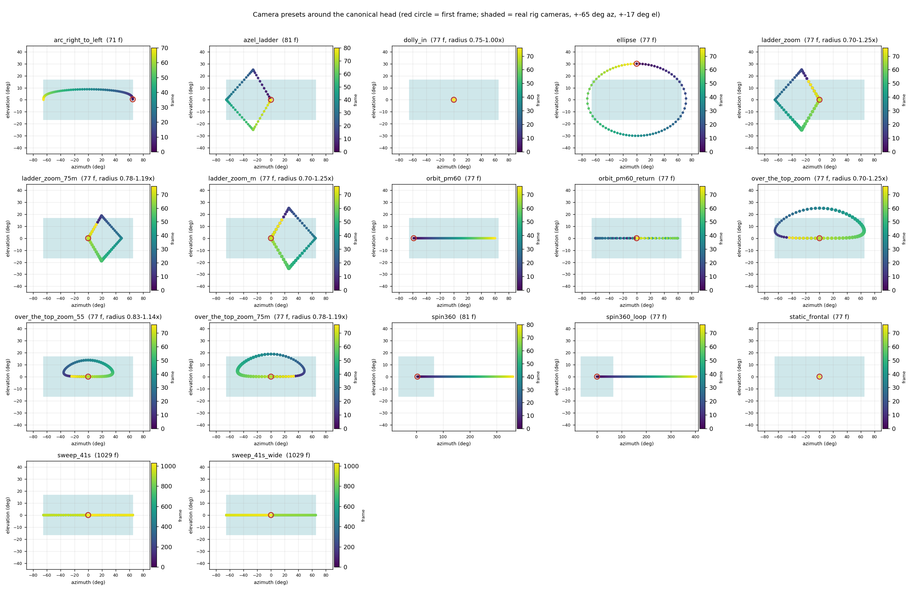

# Cameras

Every driving video is transferred onto one canonical person, and the camera moves on a sphere around this person's
head:

* **azimuth** (`az`): left/right around the head, 0 = frontal;
* **elevation** (`el`): above/below eye level, 0 = eye level;
* **radius** (`rad`): distance as a multiple of the default distance (`< 1` moves closer).

The model was trained with cameras between ±65° azimuth and ±17° elevation (the shaded box below); quality degrades
gradually beyond that, and the back of the head was never seen.

```bash
python render_conditioning.py --ref <NAME> --driving <DRV> --camera <PRESET> --out_dir cache/cond/<RUN>
```

`--camera` takes a preset name, a `.json` path spec (below), an `.npz` with camera poses, or `driving` (the camera
path stored with the driving sequence; for `nersemble8` that is `sweep_41s`).

**Timing.** A preset has its own length. If it is longer than the driving clip, it is cut (e.g. a 1029-frame preset
on a 77-frame clip shows only its start); if it is shorter, it is stretched to the clip, so the camera moves more
slowly. It is never sped up.

## Presets



Each panel shows the azimuth/elevation path (colour = frame, red circle = first frame, larger dots = farther away) against
the training range. Redraw it with `python scripts/plot_cameras.py --bank weights/driving_bank/nersemble8.npz --out
<FIG.png>`.

**Recommended** (77 frames, full model):

| preset | frames | path |
|---|---|---|
| `over_the_top_zoom` | 77 | over the top of the head and back, with a zoom in (0.70×) and out (1.25×); seamless 68-frame loop |
| `over_the_top_zoom_55` | 77 | over_the_top_zoom at 55% amplitude (gentler; for drivers who move a lot) |
| `ladder_zoom_m` | 77 | ladder_zoom mirrored (profile on the other side) |

**Long paths for the fast model** (1029 frames = the whole shipped driving sequence):

| preset | frames | path |
|---|---|---|
| `sweep_41s` | 1029 | 41 s (1029 frames) for the fast model: half-sweeps between ±65° azimuth, passing frontal every 68 frames |
| `sweep_41s_wide` | 1029 | 41 s (1029 frames) for the fast model: frontal → ±65° azimuth half-sweeps of 147 frames → frontal |

**Others:**

| preset | frames | path |
|---|---|---|
| `arc_right_to_left` | 71 | one arc from the right side to the left side, rising over the face in the middle |
| `azel_ladder` | 81 | frontal → up (az -26, el +25) → full side (az -65) → below (az -26, el -25) → frontal, short pause at each corner |
| `dolly_in` | 77 | frontal, slow push-in to 0.75× the default distance and back |
| `ellipse` | 77 | closed ellipse around the frontal view (az ±72°, el ±30°), constant speed, seamless loop |
| `ladder_zoom` | 77 | frontal → top → full profile → below → frontal, with zoom; seamless 68-frame loop |
| `ladder_zoom_75m` | 77 | ladder_zoom at 75% amplitude, mirrored (profile on the other side) |
| `orbit_pm60` | 77 | one linear sweep from 60° left to 60° right at eye level |
| `orbit_pm60_return` | 77 | frontal → 60° left → 60° right → frontal |
| `over_the_top_zoom_75m` | 77 | over_the_top_zoom at 75% amplitude, mirrored (other side first) |
| `spin360` | 81 | one full 360° revolution at eye level, constant speed, starting frontal (the back of the head was never seen in training) |
| `spin360_loop` | 77 | full 360° revolution at eye level, seamless 68-frame loop (the back of the head was never seen in training) |
| `static_frontal` | 77 | fixed frontal camera |

The presets are JSON files in [`vda/assets/cameras/`](../vda/assets/cameras); a copy with your changes, passed as
a path, works the same way.

## Your own camera path

A path spec is a JSON file with a start pose and a list of legs; each leg moves the camera from where the previous
one ended to a target over `n` frames:

```json
{"units": "deg",
 "start": {"az": 0, "el": 0, "rad": 1.0},
 "legs": [{"n": 30, "az": -45, "ease": "smoother"},
          {"n": 20, "el": 15, "rad": 0.85, "ease": "smoother"},
          {"n": 7},
          {"n": 20, "az": 0, "el": 0, "rad": 1.0, "ease": "smoother"}]}
```

* `az`, `el`: the target, in degrees with `"units": "deg"`. Without it they are normalised: ±1 = the outermost
  training camera (±65° azimuth, ±17° elevation), or half of `az_span_deg` / `el_span_deg` if the spec sets them.
* `rad`: target distance, a multiple of the default.
* A leg without a target holds the camera (`{"n": 7}` above).
* `ease`: how the leg moves from start to target: `linear`, `smooth` (default), `smoother` (starts and stops most
  softly), `accelN` (slow to fast, e.g. `accel3`), `decelN` (fast to slow).
* `el_bump`: an extra rise over the middle of the leg (half a sine, same units as `el`), for arcs over the head.

The spec's total length (sum of `n`) is its own length, cut or stretched to the driving clip as above.

**Camera poses directly.** An `.npz` with `c2w` [T, 4, 4] (camera-to-world in the canonical person's world, z axis
= viewing direction, one pose per driving frame) and optionally `K` [3, 3] (intrinsics for a 1100×1604 image) is
used as is. The presets are built with `vda.preprocess.camera` (`Rig.from_state(np.load(<driving.npz>))`,
`trajectory(spec, rig, n_frames)`), a good starting point for poses of your own.
