# Reference images

The reference image gives the generated person their appearance: face, hair, clothing, background and lighting.
The expression and the head and body motion come from the driving sequence, the viewpoint from the camera path.

```bash
python prepare_reference.py --image <PHOTO.jpg> --name <NAME>                    # ~3 min, any CUDA GPU with 12 GB
python prepare_reference.py --image <PAINTING.jpg> --name <NAME> --min_conf 0.25  # paintings, cartoons, statues
```

It runs two steps and caches the result in `cache/refs/<NAME>/`; later steps refer to it by `<NAME>`:

1. **Crop** the photo to 720×1280 (9:16) with the face at the size and position the model was trained with
   (`ref_916.png`; the crop is logged in `crop.json`).
2. **Fit** the FLAME head shape with [pixel3dmm](../third_party/pixel3dmm) (`flame_shape.npy`). Only the identity
   shape is kept: the proxy render in the conditioning uses it, so that the conditioning head has the reference's
   proportions. The fit's other outputs stay in `p3dmm/`.

Running it again with the same `--name` reuses the cache; `--force` recomputes it.

## The crop

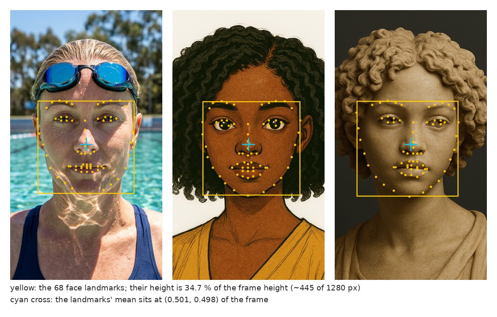

The 68 face landmarks (eyebrows to chin) span 34.7 % of the frame height and their mean sits at (0.501, 0.498) of
the frame, so the crop shows about three face heights: from above the hair down to the chest. If the photo has
several faces, the largest is used.

* **Leave margin around the head.** Where the crop reaches beyond the photo, the border pixels are repeated;
  `prepare_reference.py` warns when that is more than 5 % of the crop. The repeated pixels show up as streaks and
  floating blobs in the generation, so use a wider photo. If the image is already a 9:16 head-and-shoulders portrait
  (like the references below), `--no_crop` is usually the better choice.
* **Resolution.** The crop is 1280 px high, so the face (eyebrows to chin) needs ~445 px in the photo to be used at
  full resolution. Smaller faces are upscaled and look softer in the generation.
* **Already cropped.** An image that already follows this convention, e.g. one of the example references, can skip
  the crop: `python prepare_reference.py --image examples/teaser_swimmer/ref.png --name swimmer --no_crop`.

## What works

All shipped references are near-frontal portraits, which is what we recommend. Within that, the style is free: photos, paintings, cartoons, 3D renders and statues all work (see below), as do glasses,
sunglasses, hats and headscarves.

* **Non-photoreal faces** (`--min_conf 0.25`): pixel3dmm accepts a face only above a landmark-detection confidence
  of 0.99 by default, which stylised faces often miss. Lower it when the fit stops with a detection error.
* **Unseen parts are invented.** Whatever the photo does not show (the back of the head, the far side of the face
  in a profile view) is made up by the model. The training cameras cover ±65° azimuth and ±17° elevation around
  the front of the head; see [cameras.md](cameras.md).
* **The photo's expression** does not drive the generation; the driving sequence does.

## The shipped references

The references of the [examples](examples.md), at 360×640 here; the full 720×1280 images are `examples/<NAME>/ref.png`
after `python download.py examples`. Any of them can be used with your own driving or camera:
`python prepare_reference.py --image examples/<NAME>/ref.png --name <NEW_NAME> --no_crop` (add `--min_conf 0.25` if the fit
stops with a detection error).

<table>
<tr>
<td align="center" valign="top">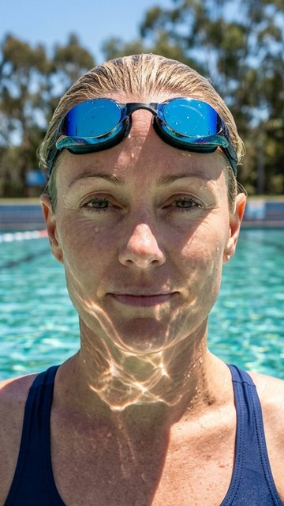<br>swimmer with goggles<br><sub><code>control_expr_swimmer</code><br><code>teaser_swimmer</code></sub></td>
<td align="center" valign="top">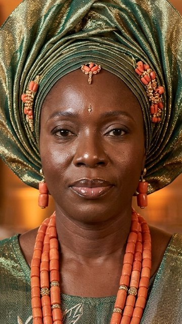<br>woman wearing a gele<br><sub><code>control_expr_gele</code><br><code>teaser_gele</code></sub></td>
<td align="center" valign="top">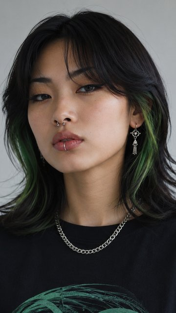<br>green hair<br><sub><code>distilled_greenhair</code><br><code>teaser_greenhair</code></sub></td>
<td align="center" valign="top">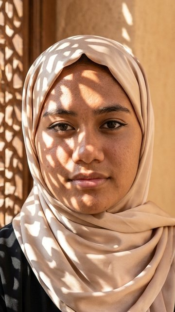<br>woman in a hijab<br><sub><code>teaser_hijab</code></sub></td>
</tr>
<tr>
<td align="center" valign="top">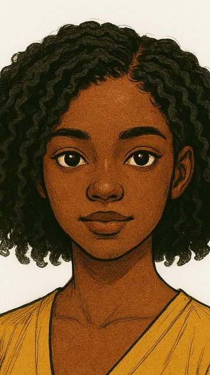<br>cartoon portrait<br><sub><code>teaser_cartoon</code></sub></td>
<td align="center" valign="top">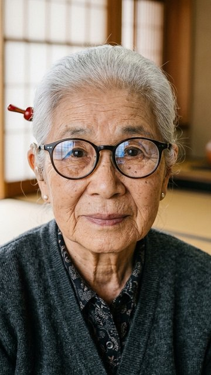<br>grandmother with glasses<br><sub><code>teaser_grandma</code></sub></td>
<td align="center" valign="top">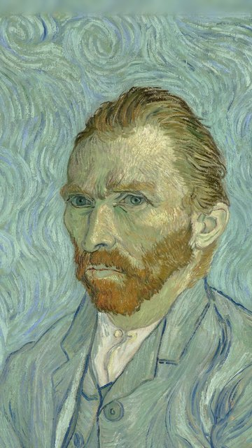<br>Van Gogh portrait<br><sub><code>distilled_vangogh</code><br><code>teaser_vangogh</code></sub></td>
<td align="center" valign="top">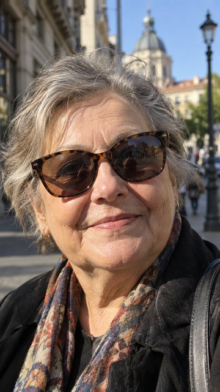<br>woman with tortoise-shell sunglasses<br><sub><code>control_camera_tortoise</code></sub></td>
</tr>
<tr>
<td align="center" valign="top">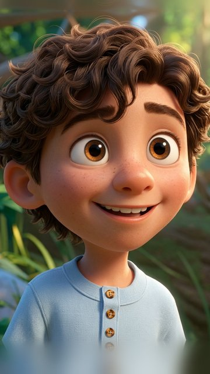<br>animated boy with curly hair<br><sub><code>control_camera_curlyboy</code></sub></td>
<td align="center" valign="top"><br>man with black-framed glasses<br><sub><code>control_camera_refraction</code><br><code>distilled_refraction</code></sub></td>
<td align="center" valign="top">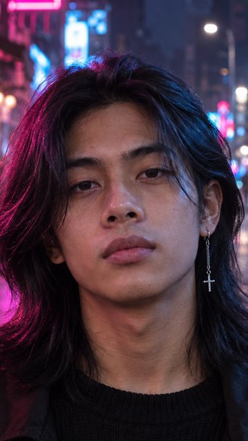<br>young man with long hair in neon light<br><sub><code>control_neck_neon_earring</code></sub></td>
<td align="center" valign="top">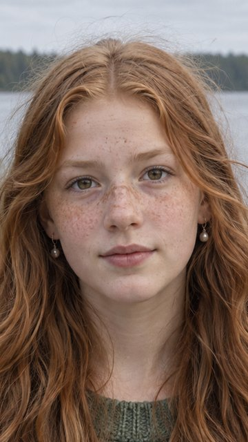<br>teenager with red hair<br><sub><code>control_neck_red_hair_teen</code></sub></td>
</tr>
<tr>
<td align="center" valign="top">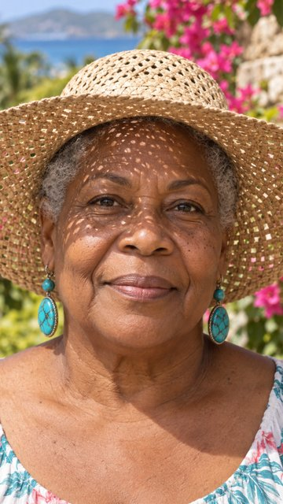<br>woman with a straw hat<br><sub><code>control_neck_straw_hat</code></sub></td>
<td align="center" valign="top">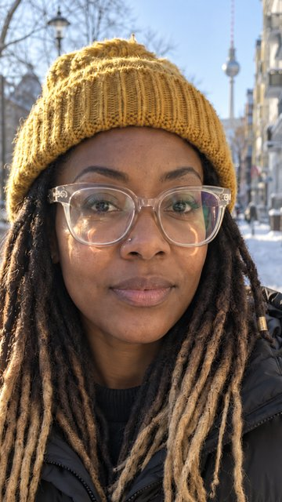<br>woman with a beanie and locs<br><sub><code>control_neck_beanie_locs</code></sub></td>
<td align="center" valign="top">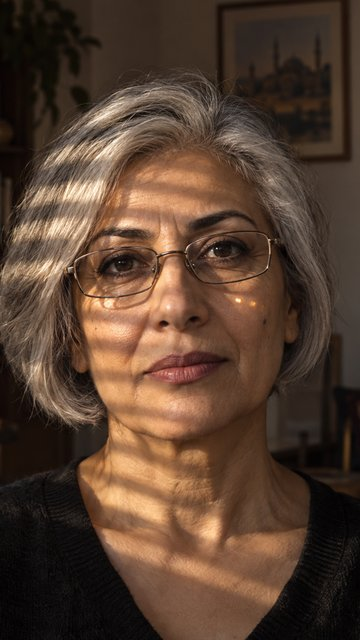<br>woman with glasses in striped light<br><sub><code>control_expr_blinds</code></sub></td>
<td align="center" valign="top">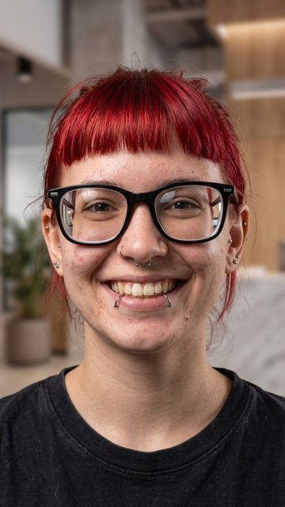<br>red bangs<br><sub><code>distilled_redbangs</code></sub></td>
</tr>
<tr>
<td align="center" valign="top">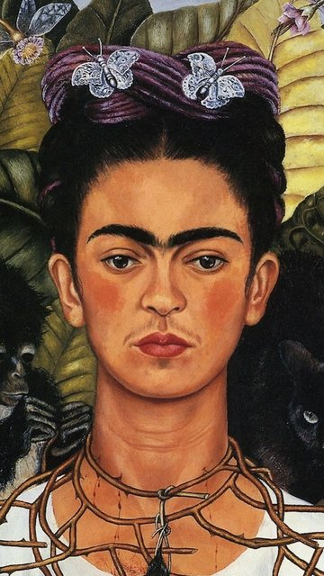<br>Frida Kahlo painting<br><sub><code>distilled_frida</code></sub></td>
<td align="center" valign="top">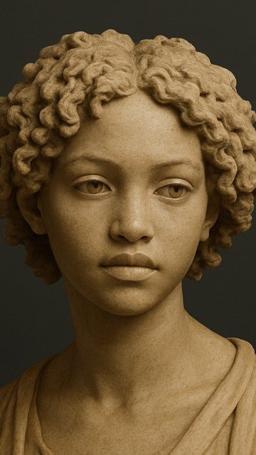<br>marble bust<br><sub><code>distilled_marble</code></sub></td>
<td align="center" valign="top">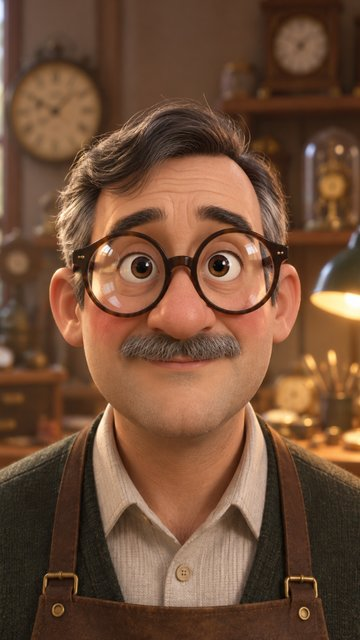<br>3D-animated watchmaker<br><sub><code>distilled_watchmaker</code></sub></td>
<td align="center" valign="top">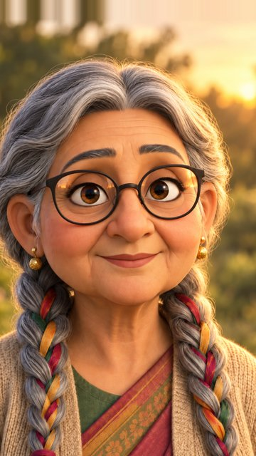<br>cartoon grandma<br><sub><code>distilled_cgrandma</code></sub></td>
</tr>
</table>
